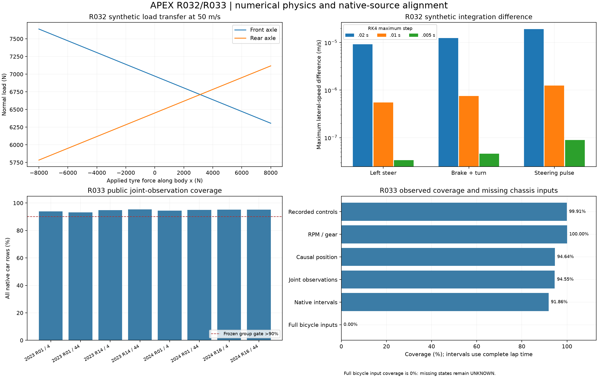

# R032 accepted: aero balance and coupled axle loads

2026-10-31. **ACCEPT_SCOPED_AERO_LOAD_TRANSFER**. The declared synthetic
force/dynamics and sensitivity/identifiability gates pass. Research foundation
remains R1 and production kernel R0. No actual Formula One aero/tyre parameter
identification, public cornering accuracy or production promotion is claimed.

[Protocol](../../research/protocols/AERO_LOAD_TRANSFER.md),
[equation map](../../research/equations/AERO_LOAD_TRANSFER_V1.md),
[model/run card](../models/aero-load-transfer-v1.md),
[complete numerical evidence](aero-load-transfer-evidence.json), and
[publication inventory](vehicle-replay-manifest.json) define the result.

## Scope and evidence sequence

Baseline4927926 passes634 tests in610.78s on Python3.12.12/Windows, with two
existing dependency warnings. The R031 reference replays exactly. Protocol
3c25875 precedes implementation. The first load checkpoint ff7756a exposed an
endpoint test failure; its command incorrectly continued to commit after pytest
failed. This is preserved in history. Fix7e63a71 encloses root bounds outward
by16 floating-point ULPs, keeping exact capacity roots bracketed. Subsequent
checkpoint commands explicitly stop on failed test/lint status.

The algebra review corrected a draft constant lateral-force slope bound before
study evaluation. At fixed longitudinal request, the ellipse's normal-load slope
can be unbounded near front saturation. The implemented solver proves a
conservative sufficient uniqueness condition over an interval containing every
possible root, or explicitly abstains. It does not choose an arbitrary root.

The research extension solves actual constrained tyre forces and static pitch
equilibrium together. Drag/additional body resistance acts at CoG, tyre forces
at road height, and downward aero load at its declared center. Transfer uses
the tyre body-x force; aerodynamic deceleration is not counted a second time.
The original R031 source/behavior and all production modules remain unchanged.

Commit bd122ad adds independent scalar bisection/DOP853, sensitivity, structural
identifiability and artifact tests. Final accepted run at
**d9f021ad36aea261e394810c3620f66cad9c5541** additionally snapshots the unchanged
R031 dependency. Source/config/protocol hashes and every trajectory are retained.

## Force, power and supported-domain results

The hand fixture yields downforce4593.75 N, drag1684.375 N,
front6747.1875 N and rear6675.5625 N, maximum error9.095e-13 N.
Zero aero/zero CoG height reproduces the original R031 trajectory exactly.
Drive unloads the front axle, braking loads it, aero balance shifts normal load,
and drag/downforce scale with squared speed under the declared priors.

The45-point force grid retains **41 supported points and4 explicit abstentions**
at front-saturation intervals lacking the sufficient uniqueness guarantee. They
remain in accounting; no unsupported force result is fabricated. Independent
bisection agrees with supported loads to1.245e-9 N and RHS coordinates to
1.714e-12 in their SI units. Maximum trajectory pitch residual is6.377e-9 Nm;
maximum power-balance discrepancy5.821e-11 W. Ellipse and dissipation gates pass.
Separate tests reject contact loss and unsupported uniqueness.

The first numerical study was rejected: independent full-capacity force
arithmetic subtracted nearly equal squared loads and invented a tiny lateral
force. Its maximum RHS difference2.294e-7 exceeded the fixed1e-7 gate. The
independent audit now handles the exact physical cap as zero lateral budget and
uses factorized unsaturated arithmetic. No tyre law, parameter, test case or
accuracy threshold was changed. The rejected run remains
`.cache/r032-first-study-20261031`.

## Independent trajectories and sensitivity

All seven fixed coast/drive/brake/left/right/combined/pulse cases pass RK4 maximum
steps.02/.01/.005 s against independently coded scalar bisection plus DOP853.
Every SI component stays below its1e-4 gate; the largest differences across all
steps are:

| State | Maximum difference |
|---|---:|
| x |3.1210e-6 m|
| y |2.0748e-6 m|
| heading |3.1329e-7 rad|
| forward velocity |2.1855e-6 m/s|
| lateral velocity |1.9263e-5 m/s|
| yaw rate |2.1934e-6 rad/s|

These measure numerical consistency, not measured-car predictive error.
All eight preregistered prior perturbations are reported: CdA/ClA/CoG height
±20%, front downforce share±.1, with terminal-state and axle-load responses.
These are conditional prior-model sensitivities, not actual-car intervention
estimates or confidence intervals.

## Identifiability result

The synthetic oracle assumes measured drag, both axle loads, known mass and
known unsaturated tyre longitudinal force at20/40/70 m/s. Public telemetry does
not provide those force/load sensors.

| Hypothetical observation/configuration | Jacobian rank |
|---|---:|
| Drag and both axle loads; five parameters |4/5|
| Same oracle, air density fixed |4/4|
| Same oracle with no longitudinal tyre-force excitation |3/5|
| Drag-only observations |1/5|

The density/CdA/ClA product ambiguity is explicit: multiplying density by1.1 and
dividing both coefficient-area products by1.1 changes oracle forces by0 N.
Relative-Jacobian null-direction residual is2.221e-16; normalized analytical/
finite-difference discrepancy1.479e-11. Real parameters identified: **false**.
No precision is invented for unavailable measurements.

## Reproducibility and boundaries

Accepted run: `.cache/r032-accepted-20261031`, recorded scientific runtime15.14s.
All results and arrays regenerate with **maximum difference0.0**. Independent
audit verifies all seven cases. Thirteen targeted tests cover equations,
contact/uniqueness rejection, structural confounds, independent code paths,
portable/immutable artifacts, tampering, false identification and numeric tolerance.
Implementation CI [41238903597](https://github.com/aayups31/APEX/actions/runs/41238903597)
passes all **664 tests** on both Python3.11 and3.12, including the synthetic study,
scientific replay and independent audit. The complete record is in project maturity status.

Study seal:
`7114c89fcfcb53a968f2645ea6285dbdbb713c1ca6895c6c5029e8a2bfc4441c`.
Evidence seal:
`e9482e74b980ae7a0a3845df6a96ddcb9ec5ac5a927682fb04aa2e77279ce99d`.

The model omits lateral load transfer, suspension/pitch dynamics, ride-height
aero maps, wheel spin and tyre thermal state. Axle stiffness, grip, CoG, density
and effective aero areas remain generic priors. Wind, actual forces and setup
are unknown. No new model enters production. Stop consuming this research
version to roll back; prior evidence remains available.

R033's companion report covers recorded observed-channel alignment. Next is
R034's matched open-loop error study, which must retain missing steering/body
states and unsupported horizons rather than treating this synthetic gate as
complete measured-car or closed-loop validation.
