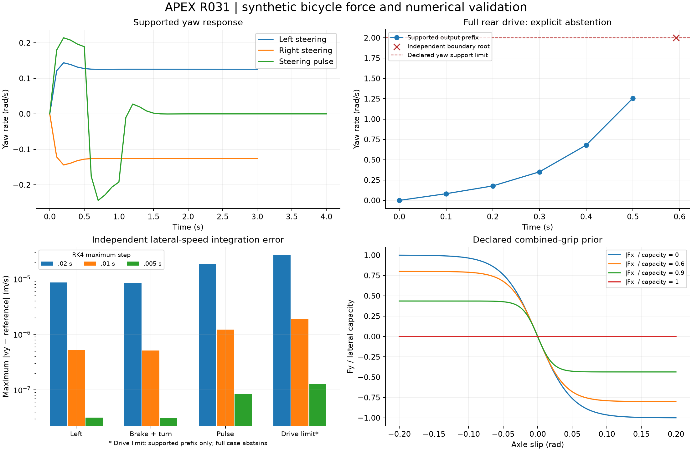

# R031 accepted: bicycle forces and numerical stability

2026-10-31. **ACCEPT_SCOPED_BICYCLE_FORCE_STABILITY**. This closes R031's
equation-level force/stability task with synthetic evidence. Research foundation
remains R1, production kernel R0. No public cornering calibration, R2/R3 maturity
promotion or production parameter change follows from this result.

See the [frozen protocol and recorded boundary clarification](../../research/protocols/BICYCLE_DYNAMICS.md),
[SI equation map](../../research/equations/BICYCLE_DYNAMICS_V1.md),
[model/run card](../models/bicycle-dynamics-v1.md),
[full numerical evidence](bicycle-dynamics-evidence.json) and
[publication inventory](bicycle-dynamics-manifest.json).

## What was built

A research-only six-state dynamic bicycle now integrates inertial position,
heading, body forward/lateral velocity and yaw. It uses road-wheel steering
radians, axle longitudinal force requests, opposing resistance and static axle
loads. Wheel forces rotate into body axes with their full yaw moment; front
longitudinal force contributes to turning when steered. The production engine's
normalized steering proxy is not reinterpreted as a measured angle.

Each axle uses a longitudinal-priority friction ellipse and dissipative tanh
lateral-force prior. Applied and requested forces, remaining lateral budgets,
ellipse utilization and reductions are exposed. No residual cornering force is
invented at full longitudinal capacity. Defaults are labelled generic priors,
not identified Formula One tyre, mass, inertia or stiffness values.

The forward-only support rejects low speed, excessive sideslip/yaw/steering,
excessive axle slip and nonfinite values. RK4 checks all four stages and each
accepted endpoint. State clipping and numerical stabilizers are absent. The
R030 straight-only adapter reevaluates power-dependent forces at every stage,
with no claim that the effective ratios identify real absolute tyre forces.

## Baseline and review sequence

Baseline a9c17cb passes 607 tests in 339.46s on Python 3.12.12/Windows, with two
existing dependency deprecations. A root-directory test invocation first failed
relative config paths; rerunning in the documented `apex_engine` directory
resolved it without code changes. The previous longitudinal reference replays
exactly, and independent DOP853 speed discrepancy is 3.769e-9 m/s.

The R031 protocol was pushed as a0a40e5 before implementation. The force milestone
2a61cad passes nine hand/invariant tests; 74d3dd2 adds nine integration, stability
and longitudinal-consistency tests. Commit 81b4e96 adds the independent solver,
immutable campaign, explicit support rejection and nine artifact/audit tests.
Commit f71b368 publishes equation and run boundaries. The accepted run was made
at f71b3689b32a8999af8ee990c08eafaa63cea743, with exact algorithm/protocol hashes
and source snapshots recorded in the evidence.

## Preserved failure and protocol clarification

The first campaign aborted on its original `near_limit_drive` request: 30 m/s,
.01 rad steering, 6200 N rear drive for 1 s. Rear capacity is 5886 N under the
declared priors, so projection consumes the entire longitudinal budget and rear
lateral force becomes zero. The car loses yaw stability and leaves support.
The original traceback remains in `.cache/r031-first-campaign.log`.

Before the second campaign, the protocol explicitly classified this unchanged
case as a mandatory abstention challenge and added an independent terminal-root
check. No parameter, control, duration, supported trajectory threshold or force
equation was adjusted to make the case finish. This is a disclosed clarification
after observing a support failure, not a claim that the original all-complete
campaign passed unchanged.

Independent DOP853 locates the yaw-rate boundary r=2 rad/s at **.5922461624 s**.
RK4 first rejects at .6000000/.5954545/.5928571 s for maximum steps
.02/.01/.005 s; time discrepancies are .007754/.003208/.000611 s, below the
declared .02 s threshold. The final completed output sample is .5 s at all three
steps. This bounded prefix is compared with DOP853; no full-horizon trajectory
is reported for the rejected case. Nonuniform actual substeps reflect interval
subdivision under the maximum-step cap.

## Force, energy and local stability evidence

- All **420** declared force-grid points satisfy ellipse utilization <=1+1e-12;
  maximum observed utilization is 1.0. Positive lateral slip power is 0 W.
- Maximum hand-fixture error is 4.547e-13 in the corresponding SI coordinate,
  below the 1e-9 tolerances. Static loads are 4905/3924 N.
- Maximum rigid-body versus wheel-work power discrepancy across supported
  trajectories is 2.328e-10 W, below 1e-7 W. Unforced disturbance energy never
  increases above the declared 1e-6 J numerical tolerance.
- Analytic zero-slip Jacobian agrees with finite differences to 5.383e-9.
  The default linearization is stable at all seven speeds, 5–110 m/s; the largest
  real eigenvalue is -3.3414/s. A deliberately oversteering fixture instead has
  a positive 3.8282/s eigenvalue at 40 m/s; instability is exposed.
- At 20/40/70 m/s, small-angle responses meet the fixed 1%/1e-6 tolerance against
  an analytical matrix-exponential reference. Maximum lateral-speed discrepancy
  across those checks is 1.775e-8 m/s. This is a local prior-model check.
- The zero-steering 40 m/s disturbance decays well beyond the required 90% over
  6 s. Straight constant-force position/speed errors are below 7e-14 m and m/s;
  the synthetic unsaturated R030 adapter matches scalar speed/acceleration
  exactly. Its mu_x=8 is a deliberately unsaturated algebra fixture, not a
  physical grip estimate.

## Independent trajectories and time refinement

Thirteen supported cases cover coast, drive, braking, left/right steering,
combined braking/turning, a steering pulse, disturbance recovery, three small-angle
speeds, constant-force motion and longitudinal-law compatibility. The fourteenth
case is the unchanged abstention challenge. All completed paths and its common
supported prefix are retained at all three timesteps.

The independent module reconstructs scalar slip, tyre forces, body wrench and
kinematics without calling the primary RHS, axle-force helper, force adapter or
RK4. DOP853 is integrated separately across each held-control interval.

| Component | Maximum difference across .02/.01/.005 s RK4 vs independent DOP853 | Gate |
|---|---:|---:|
| Inertial x |7.0304e-6 m|1e-4 m|
| Inertial y |1.7698e-6 m|1e-4 m|
| Heading |1.1306e-6 rad|1e-4 rad|
| Forward velocity |3.5609e-6 m/s|1e-4 m/s|
| Lateral velocity |2.6745e-5 m/s|1e-4 m/s|
| Yaw rate |9.0367e-6 rad/s|1e-4 rad/s|

These are **numerical consistency differences**, not measured-car prediction
errors. The maximum .01/.005 s supported-case lateral-speed difference is
1.142e-6 m/s. Both signs of steering mirror exactly. No historical telemetry,
training outcomes, benchmark data or future observed states enter this campaign.

## Reproducibility and verification

The accepted local run is `.cache/r031-accepted-20261031`; scientific runtime is
4.50 s in the recorded environment. Its source/config snapshots, input commands,
all paths, boundary state, per-regime metrics and complete inventory are sealed.
Scientific replay regenerates all gates and arrays with **0.0 maximum difference**.
Relocation, tampering, resealed false promotion, altered trajectories, missing
challenge cases and harmless numerical-rounding differences have explicit tests.
Exact stored hashes remain separate from mathematical replay tolerances.

The full local regression passes **634 tests in 556.24s**, with the same two
pre-existing dependency deprecations. All 27 R031 tests and full source/test lint
pass. Exact committed implementation CI
[41220708362](https://github.com/aayups31/APEX/actions/runs/41220708362)
passes Python 3.11 and 3.12, including the study, scientific replay and independent
audit commands. No production module was changed.

Study seal: `8525ea3405407e0006d5d6cde0a9a627ab8c90f6b94c87802c77ddaa066ddda2`.
Publication evidence seal:
`68a2d744406a767e30e8988b5c6a418be1d5fab46c4c24bcfe7fe4d46c267f30`.
Fresh-checkout commands and required artifacts are in the model/run card.

## Limits and next dependency

This is a tested equation implementation with generic priors. Actual steering,
tyre forces, grip, inertia and mass remain uncalibrated. The static-load model
omits aero, load transfer, four-wheel effects, wheel spin and thermal state.
The combined-slip allocation is a declared empirical prior. Local linear
stability is not global stability; the preserved challenge demonstrates the
failure of that inference. There are no measured-car cornering error or calibrated
uncertainty claims, no complete laps or autonomous controller, and no production
or formal maturity promotion.

Next: R032 aero balance and load transfer with sensitivity and identifiability
evidence, followed by R033/R034 recorded-control/state alignment and matched
section/lap errors. Only later R035–R038 can establish complete-lap control,
recovery and out-of-domain fallback. Rollback is to stop using this versioned
research module; previous R030 evidence and production behavior remain available.
