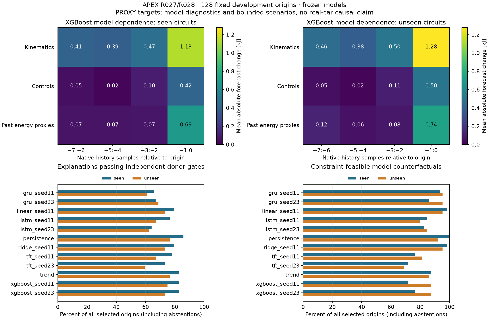

# R027/R028 public forecast explanation acceptance report

Date:2026-10-31. **ACCEPT_SCOPED_PUBLIC_MODEL_EXPLANATIONS**. R027/R028 close as
research adaptations with explicit abstention and conditional scenario validity.
Foundation review remains **R1**, production kernel **R0**, promotion **false**.

The [protocol](../../research/protocols/FORECAST_EXPLANATIONS.md),
[numerical correction](../../research/protocols/FORECAST_EXPLANATIONS_NUMERICS.md),
[equation map](../../research/equations/FORECAST_EXPLANATIONS_V1.md),
[model/run card](../models/forecast-explanations-v1.md),
[complete compact evidence](forecast-explanation-evidence.json),
[cohort](forecast-explanation-cohort.json) and
[run inventory](forecast-explanation-manifest.json) support this decision.

## Inputs and reproducibility

All ten R025 checkpoints are frozen: linear/ridge, and seeds11/23 of XGBoost,
GRU, LSTM and TFT. Persistence/trend are matched controls. No model fitting,
validation reselection, evaluation-driven threshold change or benchmark telemetry
acquisition occurred. The user explicitly scheduled these two P1 tasks before
R030; [ADR0007](../architecture/adr-0007-forecast-explanations-before-vehicle.md)
records the exception and return to the normal sequence.

The metadata-only cohort was committed before model outcomes:128 origins,
16 per event/driver, four2023 races, both drivers. Bahrain/Australia are seen
circuits; Monza/Singapore unseen. At most two origins per sequence, separated
by at least eight native rows, with a same-sequence next-sample stability pair.
These development events were already used by R026; they are not a fresh
confirmatory or permanently untouched benchmark. All nine reserved events remain
excluded before binary payload access.

Training-only2024 Bahrain/Australia windows supply the unchanged scaler, marginal
support and same-driver/compound donors. Eight distinct donor sequences exist
for104 origins (55 seen,49 unseen). The remaining24 are retained as donor-support
abstentions, not replaced. The eight-sample histories span1.36–2.521s. The1/3/5
native-sample horizons span approximately0.16–1.719s over this cohort, rather
than the proprietary paper's regular0.1s telemetry or ten-second XAI illustration.
All four targets remain **PROXY_NOT_MEASURED**.

Baseline commit d12886f:544 tests passed (two existing dependency deprecations),
19 focused forecasting/generalization tests passed, and all ten original R025
checkpoints reproduced their saved forecasts. Accepted study implementation:
`1d08ca8d2a01da20c0c1d751b848a218cf11a569`.

Accepted local run: `.cache/r027-r028-research-fp64-20261031`.
Summary seal:
`c59e1025e2055331c14affdca3aea29aaae4ed4df7cf8718c948a6a8b4db4aed`.
Cohort seal:
`459c031ae0127fcf486a0bc3e2c42f32aa46b2213346e9b1a333743b24bb8312`.
The run took158.53s on one CPU thread, Python3.12.12/NumPy2.5.3/Torch2.14CPU,
using the existing pinned native XGBoost3.0.5. Bulk windows/weights/raw predictions
remain ignored locally; the portable run copies complete sealed source inventories.

## R027: faithful model diagnostics, including refusals

Twelve players cross three feature groups with four contiguous two-sample blocks.
Four donors rank absolute output changes; four disjoint donor sequences audit
them. The reliability gate requires independent rank agreement, a held-out effect
above random expectation and joint top-three deletion at least as strong as
16 random three-player masks. Joint insertion, nearby-origin and model-seed
stability are also saved. No attention-weight or causal-attribution claim is made.

| Method | Reliable seen /55 supported | Reliable unseen /49 supported | CF successes seen /64 | CF successes unseen /64 |
|---|---:|---:|---:|---:|
| Persistence |55|49|64|59|
| Trend |53|49|56|55|
| Linear11 |51|47|63|61|
| Ridge11 |51|47|63|61|
| XGBoost11 |53|48|46|56|
| XGBoost23 |53|47|49|56|
| GRU11 |42|39|60|61|
| GRU23 |43|44|55|61|
| LSTM11 |49|43|54|51|
| LSTM23 |41|40|53|54|
| TFT11 |50|43|49|52|
| TFT23 |47|38|46|44|

The previously selected XGBoost family emits reliable diagnostics for101/104
supported origins in seed11 and100/104 in seed23;99 origins pass in both seeds.
Seven origin/seed explanations fail the faithfulness gate. Together with48
donor-unsupported origin/seed cases, they remain explicit abstentions.

XGBoost top-three seed overlap averages94.6%; GRU81.7%, LSTM75.0%, TFT72.4%.
XGBoost nearby-origin overlap ranges84.8–92.5% across seeds/strata, and donor-half
overlap76.4–79.6%. A smooth-looking explanation is therefore not assumed stable.

Fixed-event sequence-bootstrap95% intervals for the held-out top-three mean
effect minus all-player random expectation are positive: XGBoost11 seen
[0.435,0.540]kJ/unseen[0.462,0.577]kJ; seed23 seen[0.437,0.540]kJ/unseen
[0.446,0.558]kJ. These intervals condition on these events and donor procedure;
they do not establish population generalization, causal importance or FDR discovery.

Newest kinematics and past-energy blocks have the largest average response in
this slice. Feature groups are correlated by the energy proxy itself. Diagnostic
splices can break coupled equations or temporal boundaries; their constraint
failures are counted. Reliability measures the declared model dependence, not
physical admissibility of a spliced history.

## R028: independently valid finite-catalogue scenarios

All55 speed-factor/throttle-offset combinations are evaluated subject to source
consistency, fixed priors, unprojected wheel-load bounds, coupled kinematics and
training-only marginal support. Brake, time intervals, lag and static identities
are immutable; all four past energy proxies are recomputed. The goal is a mean
projected forecast decrease of10%, at least.01kJ, over the matched horizons/wheels.
Future actual targets never choose a scenario or explanation.

The same candidate crosses both XGBoost seeds' own targets at **102/128 origins**:
46/64 seen and56/64 unseen. The remaining26 abstain:25 have no jointly crossing
feasible catalogue member; one source history lies outside training marginal
support (2023 Monza,driver4,native row28115), and is retained without repair.
Median dimensionless scenario cost is.25. Optimality is exhaustive within this
55-member catalogue, not over arbitrary controls or continuous trajectories.

The independent audit validates all1,329 single-method successes across twelve
methods, reconstructs every candidate mask and scalar finite minimum, and reloads
1,095 selected learned-model forecasts separately. Maximum independent reload
difference is5.11e-15kJ. Joint-seed primary minima also pass. Unsupported/impossible
cases are retained, rather than silently forcing a crossing.

### Evidence limits that matter

- The objective is the **mean**, not every wheel/horizon. For the102 jointly
  successful primary scenarios,167/1,224 output cells increase in XGBoost11 and
  157/1,224 in seed23. Maximum increases are1.925kJ and1.560kJ respectively.
- 100 scenarios lower speed; one raises speed10%, and one raises throttle.2 while
  reducing the model's forecast mean. Both non-monotone model responses and their
  exact origin/parameters are preserved in the evidence. They warrant later
  intervention/model-exploitation work, not a driving recommendation or post-hoc
  removal from this frozen study.
- Marginal support and proxy consistency are necessary, limited checks. Actual
  actuator, friction-circle, full path, thermal and race-control feasibility are
  **UNKNOWN**. No causal VSC effect or strategy benefit is established.
- Negative raw predictions and their nonnegative projection remain visible. For
  example, trend's largest correction is71.66kJ; it is a weak baseline, not an
  explanation-quality success converted into forecast accuracy. Per-case temporal
  projection diagnostics are also retained. Inputs are never clipped into support.

## Numerical failures, replay and final checks

Two incomplete attempts are preserved. The original float32 linear adapter
failed the unchanged cross-batch tolerance; fixed32-row neural padding passed
synthetic tests but still failed on real GRU inputs. Their invariant failures
led to the documented precision correction, not gate relaxation or cohort changes.
Original R025/R026 checkpoints/loaders/results are unchanged.

Float64 evaluation preserves stored parameter values after the original float32
normalization. The real128-origin/ten-checkpoint
[numerical preflight](forecast-explanation-numerical-preflight.json) now passes:
max batch2/batch128 difference6.22e-15kJ. Historical baseline drift is disclosed
for every method: zero for XGBoost/persistence/trend, at most3.51e-6kJ elsewhere.

The portable scientific verifier reloads all checkpoints and regenerates the
cohort, donors, coupled candidates, raw forecasts, rankings, metrics, abstentions
and decisions: **maximum raw reload difference0.0kJ**. A second implementation
independently audits source equations, ranks/reliability gates and finite minima.
Tests cover hand fixtures, irrelevant/constant predictors, misleading donors,
feasibility failures, ties/impossibility, seed robustness, source identity,
protected-event access, relocation, byte corruption, resealed false choices and
attempted smoke-to-public promotion.

The exact implementation's GitHub Actions
[run41178319213](https://github.com/aayups31/APEX/actions/runs/41178319213)
passes Python3.11 and3.12, including the full suite, lint and CLI study/replay/audit
steps. Final local Windows/Python3.12 regression also passes **582 tests**
(544 baseline plus38 new), with two pre-existing dependency deprecations,
in470.78s. No production component or public calibration maturity is promoted.

## Next dependency

Return to **R030 longitudinal acceleration/drag calibration**. It must use accepted
reference geometry and source telemetry, training/validation/held-out separation,
identifiability and section-error comparisons against a transparent baseline.
R031 and later closed-loop/tyre/fuel/ERS/strategy/world-model gates remain pending.
