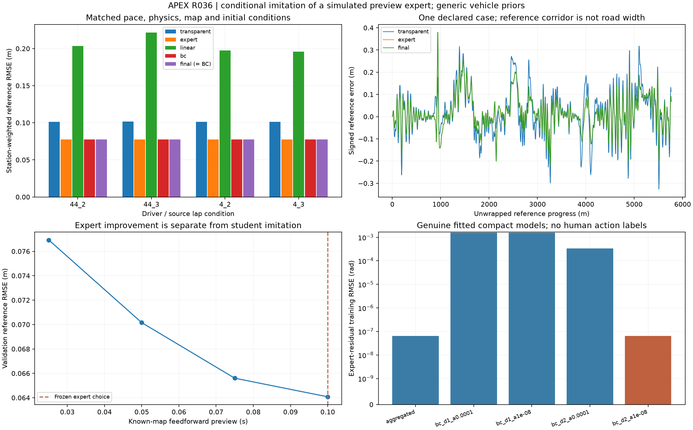

# R036 conditional imitation driver

2026-11-01. **R036 DONE: ACCEPT_CONDITIONAL_IMITATION_DRIVER.** Every declared
acceptance and replay gate passes within the conditional simulated-expert scope.
Foundation R1 and production kernel R0 remain unchanged. The
[protocol](../../research/protocols/IMITATION_DRIVER.md),
[source/sequence ADR](../architecture/adr-0008-conditional-imitation.md),
[data contract](../data/imitation-driver.md),
[model/run card](../models/imitation-driver-v1.md) and
[equation map](../../research/equations/IMITATION_DRIVER_V1.md) define the scope.

## Baseline and source

Base `3b83de4b2c12aa514e18622af8e81e43a56dab8f` passed690 tests on Python3.11/3.12
in CI41244984366. The new local baseline produced689 passes and one pre-existing
offline-Jolpica subprocess timeout. Its traceback reported a negative remaining
timeout during the clock/date change; its82330.38s elapsed value is unusable as a
compute measurement. The unchanged isolated test passed in21.82s. No timeout or
source behavior was relaxed. The final full regression now passes713 tests in
706.01s with the same two existing dependency warnings. All713 also pass on
Python3.11/3.12 in [CI41350406803](https://github.com/aayups31/APEX/actions/runs/41350406803),
including all artifact workflows. Final held-out scientific gates also pass.

A fresh R035 disturbed-circle reference passes, seal
`89d42bea396787ed2f518ae1968c8665ad7bbedd0fcb6e03dc01dd89e84583df`.
R035 calibration replay passes unchanged. R036 prepared-source seal:
`44b927325c958198f3239000957dc6970b79ef8afa98a0d9d53d534ad95e963b`.
Its parent is the accepted conditional R035 study, not calibrated real-car physics.
All9 protected benchmark events remain untouched.

## Frozen training result

Development seal `69ac56b7364119fee1dd0a5ee2277e0b99356b0a8116a4e892c19871b7f1dfc2`.
The [full development results and weights](imitation-development.json),
[development summary](imitation-development-summary.json) and
[source condition catalog](imitation-condition-catalog.json) were pushed in
`331863e` before any R036 held-out learner evaluation.

All action labels are **SIMULATED expert steering corrections**, not measured
human actions.2023 Bahrain/Monza conditions train;2024 Bahrain validates;2024 Monza
tests. There are16 original expert episodes with22,600 labelled states, plus16
learner-executed training episodes with another22,600 labels. Training-only weighted
means/scales and equal collection-round/condition weights prevent row-density or
validation/test leakage. Source/driver IDs and absolute XY/station are not features.

Validation chooses a.10s known-map feedforward preview. Its expert lateral MSE is
.004105893534m². Four genuine supervised models compare linear/quadratic ridge and
two penalties. The selected initial behavior-cloning model has45 coefficients,
degree2 and alpha1e-8; validation MSE.004105885401m². The best linear model gives
.018548433873m². Stronger quadratic regularization gives.186228874628m²; this poor
candidate is retained rather than hidden. The aggregated checkpoint gives
.004105885401m² and adds no meaningful validation improvement, so initial BC is
retained. Every candidate and all68 development rollouts are preserved.

The improvement of the analytic preview expert is separate from the student's
ability to imitate it. A compact quadratic model can represent this analytic
target almost exactly. This is controlled conditional imitation infrastructure,
not discovery of new driving knowledge or superiority to the expert.

## Verification and stopping gate

Eight core policy tests, seven split/fit/gate tests and eight artifact tests pass.
Synthetic development replay reproduces all34 paths exactly; independent scalar
features match and QR versus primary-SVD prediction difference is7.75e-16rad.
The complete synthetic pipeline and replay checks also pass, with explicit
SIMULATED_EXECUTION_ONLY status and no public-task eligibility. Its separately
trained smoke policy is stable but loses to R035 on the held-out ellipse:
RMSE ratio1.295257, P95 ratio1.450036. That failed improvement gate is retained;
pipeline execution does not establish policy superiority or broad robustness.
Portable artifacts,
genuine training, frozen model selection, actual reserved-event guards, changed
payloads and resealed false completion are tested.

Before final test execution, all68 source-bound development dynamics replayed
with zero difference. Independent feature differences were<=2.220447e-16 and QR/SVD fitted
prediction differences<=1.361411e-14rad. The [run-bound receipt](imitation-development-replay.json)
binds the full pre-test verification to the frozen development seal. The final policy competes with
R035, expert, linear and initial BC on the complete matched eight-case nominal/
disturbed test catalog, followed by four timestep refinements and independent
held-action replay. Duplicate checkpoint identities are disclosed. The task can
close only with at least10% nominal macro tracking improvement, each-driver gains,
unchanged pace/physical limits, complete stable laps and every numerical gate.

## Limits and next dependency

Public steering/body lateral measurements remain unavailable. Generic vehicle
priors, supplied maps/localization, existing development-event history and the
large R035 source-pace shortfall remain. This learns steering only; longitudinal
control stays transparent. A bounded correction does not establish OOD detection,
fallback or multi-lap recovery. R037/R038 remain the next broader evidence gates.

## Primary held-out results

The unchanged frozen model was evaluated after model/choice publication. Summary
seal `2f549c5224413fde09f5d99af2043305c5cac81ce49daa9afd9647a2be4264ae` binds the
[primary evaluation](imitation-evaluation-results.json) and
[summary](imitation-evaluation-summary.json). All eight final nominal/disturbed
cases pass, with44 saved comparator/refinement runs. Final and initial BC reference
the same frozen checkpoint; they are not independent model evidence.

| Nominal comparator | Macro station-weighted reference RMSE(m) |
|---|---|
| Frozen R035 | .101435780 |
| Analytic preview expert | .077450980 |
| Best linear learner | .204733785 |
| Selected quadratic BC / final | .077451083 |

The final learner reduces nominal macro RMSE23.6452% versus R035. Driver-specific
RMSE ratios are.763978/.763118, and P95 ratios.743811/.742365. All nominal finish
times are133.4183–133.4199s, satisfying the unchanged pace noninferiority gate.
This is conditional reference tracking, not source GPS accuracy or real F1 pace.

The peak-error tradeoff is retained: worst nominal reference error rises from
R035's.326161m to.383115m despite better RMSE/P95. Across all eight cases, including
the initial.4m/.01rad disturbances, maximum error is.593486m and P95<=.194635m.
All disturbances end within.068929m of the reference. No steering-rate/angle or
learned-residual projection occurs; shared physical force limits do intervene and
their counts are preserved. Maximum friction utilization squared is.568887,
minimum contact3708.514879N, pitch residual<=9.51059e-9Nm and power identity error
<=6.98492e-10W.

All four nominal timestep refinements pass: maximum common-station XY difference
.000025022m, speed difference.000167616m/s and finish difference.000012450s.
The scalar-bisection/DOP853 audit completes one1335-interval final-policy lap with
maximum XY difference.002029037m and body-velocity difference.000030133m/s. Another
32 representative nominal intervals pass. Full regeneration of all44 saved runs
has zero difference; the independent lap/interval audit also passes again in the
[final replay receipt](imitation-evaluation-replay.json). Actual artifact copies
pass [portability and tamper checks](imitation-driver-boundary-checks.json),
including rejection of a resealed changed model choice and a reserved event header.
An independent [saved-action bound inspection](imitation-control-bound-check.json)
checks58,927 held actions across all44 runs. Its maximum steering rate exceeds
1.5rad/s only by floating-point rounding (1.5000000000000002).

## Published evidence and interpretation

The [run-bound evidence](imitation-driver-evidence.json),
[publication manifest](imitation-driver-manifest.json) and
[sealed completion receipt](r036-completion.json) bind the frozen training,
primary results, full replay, boundary checks and713-test regression evidence.

The top-right example is2024 Monza driver44/lap2; expert/final curves overlap.
Posthoc diagnostics show teacher-forced residual RMSE6.79531e-8rad on simulated
expert states and maximum autonomous expert/student XY drift1.72889e-5m. These
measure imitation of the analytic expert, not measured human driving accuracy.
The local CPU policy-head benchmark is113.98microseconds/row; it excludes feature
construction and vehicle integration and is descriptive rather than a latency gate.

The simulated final laps remain47.3753–48.3086s slower than their source records;
posthoc native-speed RMSE is24.7137–25.2164m/s. Improved conditional tracking does
not resolve that pace mismatch. The analytic expert remains equally accurate and
simpler. The retained smoke failure and higher nominal peak error preclude a
broad robustness claim. R037 multi-lap drift/recovery, then R038 OOD/fallback,
remain next; neither is implemented or credited by this completion.
