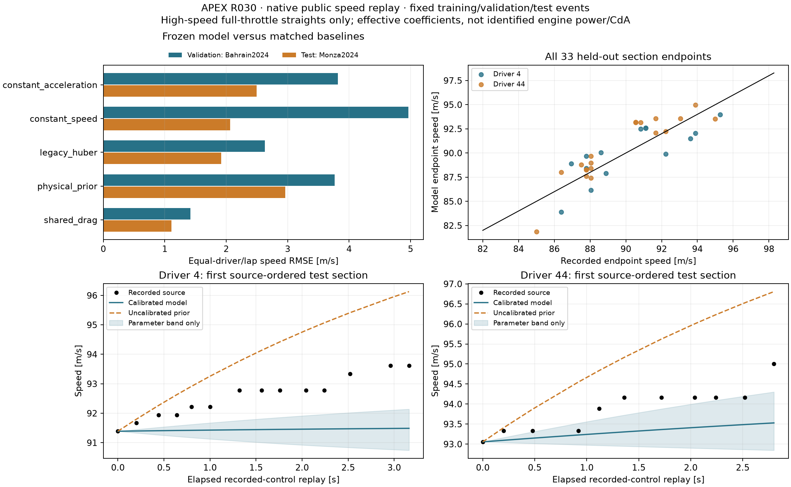

# R030 accepted: effective longitudinal power/drag calibration

2026-10-31. **ACCEPT_SCOPED_LONGITUDINAL_CALIBRATION**. R030's declared
high-speed/full-throttle section gate passes. Research foundation remains R1,
production kernel R0, no component or formal R2/R3 promotion. The
[protocol](../../research/protocols/LONGITUDINAL_CALIBRATION.md),
[equation map](../../research/equations/LONGITUDINAL_CALIBRATION_V1.md),
[model/run card](../models/longitudinal-calibration-v1.md),
[source preflight](longitudinal-source-preflight.json),
[frozen cohort](longitudinal-section-cohort.json),
[development checkpoint](longitudinal-development-summary.json),
[fitted model evidence](longitudinal-development-models.json),
[final numerical evidence](longitudinal-calibration-evidence.json) and
[run inventory](longitudinal-calibration-manifest.json) define its scope.

## Baseline and scientific sequence

At ff5832b,582 tests pass in470.06s (two existing dependency warnings), the
accepted R029 geometry replays, and the existing synthetic Huber calibration
runs on525 rows. Its in-sample acceleration MAE.225624m/s2 is execution evidence,
not comparable to the new held-out speed-error target.

The R030 preregistration13c9b67 precedes coefficient fitting. Source extraction
and guard tests are pushed as c53dbf0; f430e97 freezes150 source-selected sections
before fitting. Physics/scoring equations and hand fixtures are pushed as
4f1c3c2, the complete study/audit/CI interface as bfbcba1. The training/validation
checkpoint is pushed as **e6f6445 before Monza test errors are evaluated**.
No cohort, source filter, fit bound, baseline or threshold is changed afterwards.

Training uses entire2023 Bahrain/Monza events, validation2024 Bahrain, final test
2024 Monza. All88 source laps are inherited unchanged from R029. The source-only
filters require native car channels, clock agreement, full throttle, no brake,
40–105m/s, constant known DRS state, low reference curvature, supported causal
position lag and five-sample speed warmup. Gaps/rejected rows are not bridged.
Sections span2–3.5s, with no observed-speed resets after initialization.

The source preflight yields83 training,34 validation and33 test sections. Test
sections cover18 of the20 frozen source laps:8 driver4 laps and10 driver44 laps.
The other laps remain visible in source accounting. All30,299 native lap rows
are accounted for;6,628 meet row eligibility before minimum section duration.
Rejections include14,477 outside the full-throttle/high-speed domain,7,968 outside
straight reference support,820 unsupported causal positions,403 warmup failures
and3 unknown DRS codes. No error-based filtering occurs.

These are reused development events with supplied, offline registered reference
geometry; neither permanently untouched testing nor online localization is
claimed. All nine reserved whole-event benchmarks remain excluded before native
payload access. Native car/lap tables and R029 geometry remain source-sealed.

## Identification and frozen model choice

The selected model fits `a=p*u/v-d*v2-r`, per track/driver, with r=.14715m/s2 PRIOR.
It identifies conditional effective ratios, not engine power, actual mass or
CdA. Column-normalized bounded least squares fits native speed increments;
left-endpoint Euler identification is disclosed. Recorded-control replay uses
RK4 maximum step.05s. Model speed is never teacher-forced or clipped.

The DRS-specific class is ineligible because2023 Bahrain/driver44 has no open
DRS training samples; its design is rank deficient. The missing effect is not
inferred from validation/test or replaced with an undocumented constant. The
shared-drag class has full-rank normalized condition numbers6.01–27.27, sufficient
training counts, and no active bounds in its original four fits.

| Training cell | Effective p [W/kg] | Shared d [1/m] | Normalized condition |
|---|---:|---:|---:|
| Bahrain/4 |557.517|0.000802005|6.012|
| Bahrain/44 |554.671|0.000764474|7.382|
| Monza/4 |594.552|0.000748435|19.582|
| Monza/44 |339.893|0.000382131|27.270|

Validation RMSE is1.416m/s, against legacy Huber2.629, physical prior3.764,
constant causal acceleration3.817 and constant speed4.964m/s. All parameters,
bootstrap draws, prior sensitivity and this validation-only choice are frozen
before testing. The original sim_core calibration and production cars are unchanged.

## Held-out recorded-control section errors

Errors exclude the observed initial node. Aggregation gives equal sections per
lap, equal laps per driver, and equal drivers. All methods use the same source
sections; the constant-acceleration baseline uses only causal pre-origin speeds.

| Method | Speed RMSE [m/s] | Speed MAE [m/s] | Mean absolute endpoint error [m/s] | Mean absolute speed-integral distance error [m] |
|---|---:|---:|---:|---:|
| Calibrated shared drag |**1.110**|**0.844**|**1.427**|**2.202**|
| Legacy Huber |1.918|1.309|2.078|3.403|
| Constant speed |2.063|1.401|2.120|3.751|
| Constant causal acceleration |2.497|1.824|4.181|4.906|
| Uncalibrated physical prior |2.963|2.455|4.781|6.624|

The calibrated model reduces RMSE42.1% versus the best baseline,46.2% versus
constant speed,55.6% versus causal acceleration and62.5% versus the physical prior.
This exceeds the preregistered5% improvement requirement against every baseline.
Driver4 RMSE is1.222m/s versus prior2.955; driver44 is0.984m/s versus prior2.971.
Both drivers separately beat constant speed and the uncalibrated prior.

The paired500-draw lap bootstrap gives selected-minus-best-baseline MSE
**-2.446m2/s2**,95% interval **[-4.539,-0.651]m2/s2**. It conditions on these
drivers and this one test event; it is not population-level race generalization.
DRS-state, initial-speed, duration, per-lap and per-section errors are all saved.

## Uncertainty, support and limits

- All200 training-lap bootstrap draws produce valid full-model fits and test
  trajectories. They represent parameter variability, not all observation/model
  uncertainty. The resulting95% parameter-only bands cover **35.0%** of recorded
  test nodes, with mean width1.114m/s. Do not call them95% prediction intervals.
- Eleven of33 test starts are outside their cell's training speed range. They
  remain scored and individually identified; no difficult case is replaced.
- Monza/44's bootstrap p interval reaches the100W/kg lower PRIOR bound;2% of that
  cell's draws have an active bound. Its broad ratio uncertainty is retained.
- Rolling loss is fixed, with +/-50% prior-sensitivity fits disclosed. Wind,
  gradient, fuel mass, ERS state, actual drivetrain and tyre/traction states are
  not identified. DRS causal effect, absolute engine power and CdA remain UNKNOWN.
- The domain is short high-speed/full-throttle/low-curvature replay. Braking,
  low-speed traction, partial-throttle dynamics, full-lap engine alignment,
  autonomous control and a validated world model are separate unfinished gates.
- Integrated distance uses source speed/time, not surveyed position ground truth.
  R029's reference shape and registration are supplied conditions, not a validated
  online position estimator. No measured wheel-energy or proprietary-data claim.

## Numerical replay, independent audit and regression

Maximum .05s/.025s RK4 speed difference is2.594e-10m/s, below the.002m/s gate;
there are no selected-model physical-domain violations. Portable verification
regenerates native sections, refits training, reproduces validation selection,
all200 parameter draws and every test array/metric/gate: **maximum reload
difference0.0m/s**.

Independent scalar equations check seven successful constrained fits (including
partial fits of the ineligible richer class), maximum normalized KKT violation
3.382e-13. DOP853 independently reproduces all165 method/section trajectories,
maximum speed difference6.659e-10m/s, and separately reconstructs hierarchical MSE.

The implementation's local suite passes606 tests in456.50s, with only the two
pre-existing dependency deprecations. The initial24 added tests cover native causal/source/units,
coefficient recovery, analytic gradients, rank failure, integration convergence,
hierarchical hand fixtures, held-out target independence, immutable/portable
checkpoints, falsified acceptance, protected payload guards and smoke promotion.
Lint passes. Exact checkpoint CI
[41214310018](https://github.com/aayups31/APEX/actions/runs/41214310018) passes
Python3.11/3.12, including the CLI smoke and independent DOP853 audit.

A subsequent verifier-only correction separates exact hashes of stored payloads
from tolerance-based mathematical refits: file/content integrity remains exact,
while refit values use the unchanged rtol1e-6/atol1e-7 contract. An additional
regression checks harmless coefficient-rounding differences. It changes no fit,
section, prediction, model choice or scientific gate. Public replay still has
zero difference. Final local regression passes **607 tests** in399.95s with the
same two dependency warnings; the25 new tests include this portability check.

Dataset seal: `2559478bf6a00a40f1850222035a86bf0046e14b857d1c81973513e209b3b9ab`.
Development seal: `82fc70acfef2a5c730ba908d6659ff35a1730aac1d5663612029c03333081e99`.
Final study seal: `46e854809b2b22ecc89ba8e91713c3bf167f0191a316cfd39fe126e3faf4d286`.
Evidence seal: `bac796f97986aa8d2fe3d5d559913edce939c414471ef528af622a80148155ae`.
Accepted local run: `.cache/r030-public-evaluation-20261031`.

## Next dependency and rollback

R031 adds the research bicycle lateral model and friction ellipse with force,
sign, combined-demand and stability tests. R033's full recorded-control/state
alignment remains separate. The production kernel is unchanged; rollback is to
stop consuming the versioned research artifact, leaving historical evidence and
all previous models intact. Stronger uncertainty and out-of-domain validation
are required before any driving/planning use.
