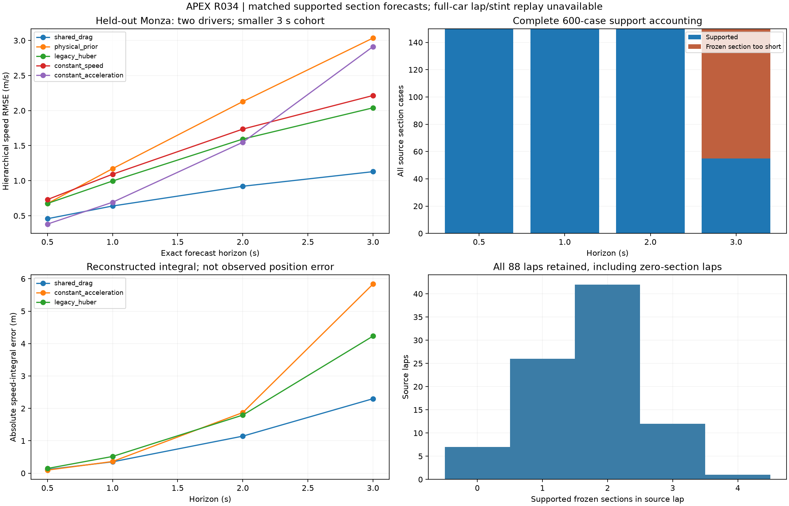

# R034 matched open-loop errors

2026-10-31. **ACCEPT_SCOPED_ERROR_REPORT**. The reporting component accounts for
all150 frozen sections and88 source laps. It does not validate continuous full-car
lap or stint physics. Foundation remains R1, production kernel R0.

The preregistered [protocol](../../research/protocols/OPEN_LOOP_REPLAY_ERRORS.md)
freezes R030's selected shared-drag model and four baselines, without refitting.
R033 source seal `42cede289de897d6153ae3f66d84631de5394911fa979d5df453316b92912620`
and R030 model payload `598d646b23e1eeb8ea0d6a88a5f2f4d54656ef7af91e4de01597abc2460c713b`
bind the inputs. Reused2023 Bahrain/Monza are training events;2024 Bahrain is
validation and2024 Monza is test. Nine protected benchmark events remain untouched.

The [sealed evidence](open-loop-errors-evidence.json) includes every score,
abstention, source catalog, original run manifest and both verification receipts.
Its publication is bound by the [figure/evidence manifest](open-loop-errors-manifest.json).



## Matched held-out results

Each method sees identical initial states, causal history, controls, forecast nodes
and exact endpoints. Endpoint target speed alone is reconstructed by interpolation.
Initial nodes are excluded from errors. Sections/laps/drivers/events receive equal
weight at each level. The3s cohort is smaller and must not be treated as identical
to the shorter-horizon cohort.

| Horizon(s) | Sections / laps | Shared drag RMSE(m/s) | Legacy | Physical prior | Constant speed | Causal acceleration |
|---|---|---|---|---|---|---|
| .5 | 33 /18 | .457146 | .674776 | .673453 | .730530 | .380797 |
| 1 | 33 /18 | .638680 | .995231 | 1.171552 | 1.091844 | .692035 |
| 2 | 33 /18 | .920463 | 1.593520 | 2.128813 | 1.735922 | 1.547763 |
| 3 | 19 /14 | 1.128661 | 2.039386 | 3.034938 | 2.215095 | 2.912884 |

The causal acceleration baseline is better at.5s. This is retained; the frozen
choice is not retuned. Shared drag's3s absolute endpoint error is1.369888m/s and
absolute speed-integral error2.299695m. These distances are reconstructed speed
integrals, not independently observed position errors. No raw prediction exceeds
the declared0–120m/s numerical domain in this study.

Across all splits,505/600 requested section/horizon cases are supported and95
explicitly abstain because their frozen source section is shorter than3s. The five
methods produce2525 saved paths. Test scores retain both drivers at every horizon.
Track, origin-speed-band and DRS strata are saved alongside every section record.

## Lap and stint support

Every lap has a source-bound catalog entry and a separate sampled-lap constant-speed
diagnostic. That unvalidated kinematic baseline spans native timing gaps; it is not
a physical replay result. Supported-section aggregates are explicitly labelled
`SECTION_AGGREGATE_NOT_CONTINUOUS_REPLAY`. Native source stint IDs and all native
stint lap numbers expose omitted intervening laps. Unknown memberships stay null.

All complete physical lap/stint errors remain null: measured steering/body state
and all-regime vehicle calibration are absent. Braking, cornering, low-speed,
continuous-lap and continuous-stint physical validity are not claimed.

## Reproduction and verification

Run with the accepted local immutable datasets:

```powershell
apexsim open-loop-error-study --recorded .cache/r033-public-20261031 --development .cache/r030-development-20261031 --output .cache/r034-public-NEW
apexsim verify-open-loop-errors .cache/r034-public-NEW
apexsim audit-open-loop-errors .cache/r034-public-NEW
```

Accepted artifact `.cache/r034-public-20261031` has summary seal
`8e6c5ae08b4768afd8311b7a3a82c055c482fcc88859607da774f84270f24092`.
Scientific regeneration has zero difference. Independent scalar laws/DOP853 check
all2525 paths with maximum speed difference5.555741e-9m/s, below1e-6, and independently
reconstruct all split/horizon metrics and hierarchy. Exact file inventories are
separate from numerical replay tolerances.

Ten targeted tests pass: hand metrics, causal future-target independence, exact and
short endpoints, hierarchy, missing stint, source guard, portability, immutable
destination, tampering and resealed false completion. The fresh pre-change full
suite passed664 tests. Implementation commit
`7ef09f1ba5a4be5dff9fbe1cec47a415e7350bce` passed674 tests and all workflow steps
on Python3.11/3.12 in [CI41242991828](https://github.com/aayups31/APEX/actions/runs/41242991828).
The final combined regression is recorded with R035. No production behavior is changed.
