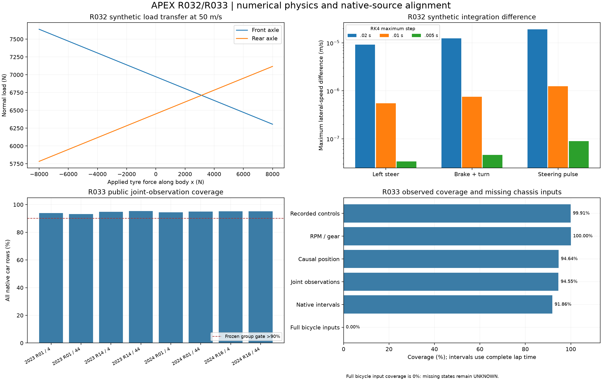

# R033 accepted: causal recorded observation alignment

2026-10-31. **ACCEPT_SCOPED_RECORDED_OBSERVATION_ALIGNMENT**. R033's declared
coverage/causality/native-input gates pass on the frozen public cohort.
**Full measured bicycle-input coverage remains0%**: missing steering, body
velocities/yaw, fuel and battery are explicitly UNKNOWN. Research foundation R1,
production kernel R0, no production or formal R2/R3 maturity promotion.

[Protocol](../../research/protocols/RECORDED_REPLAY_ALIGNMENT.md),
[observation/equation map](../../research/equations/RECORDED_REPLAY_ALIGNMENT_V1.md),
[model/run card](../models/recorded-replay-alignment-v1.md),
[complete native evidence](recorded-replay-alignment-evidence.json), and
[publication inventory](vehicle-replay-manifest.json) define the scope.

## Inputs and sequence

Protocol3c25875 freezes coverage thresholds before public alignment outcomes.
Commit ee18da5 introduces native causal alignment and independent scalar pointer
tests. Commit **d9f021ad36aea261e394810c3620f66cad9c5541** freezes the portable
workflow, source guards, artifact tests and CI before public coverage evaluation.
No gate, lap, section, tolerance or denominator is changed afterwards.

All **88** accepted R029 laps and **150** frozen R030 sections are inherited
unchanged. They span Bahrain/Monza, drivers4/44, and four whole events:
2023 Bahrain R01/Monza R14 training,2024 Bahrain R01 validation,2024 Monza R16
test. These events were previously used in development. The nine permanently
reserved events remain untouched; no source is acquired or unpickled.

The portable package copies the accepted source dataset and exact native
position Parquet exports bound to the same four original archive manifests.
Every event is guarded before binary access. The source dataset seal is
`2559478bf6a00a40f1850222035a86bf0046e14b857d1c81973513e209b3b9ab`.
Geometry is R029's frozen offline registered reference, not online localization
or surveyed road/chassis truth.

## Alignment and observed-state contract

Half-open lap membership prevents a native car sample from belonging to two
adjacent laps. Native SessionTime is finite/strictly increasing and checked
against Date increments to1e-6s. No telemetry `Time` substitution or fitted
clock offset is used. Source consistency does not identify physical latency.

At each native car row, the latest same-lap native position is selected
backward. A prior same-lap position, age<=.35s, gap<=.75s, native Source=pos,
OnTrack and finite XY are required. No future match, interpolation, gap bridge,
lap substitution or driver/event crossover is allowed.

Speed and throttle convert to SI/fractions. Brake stays boolean; RPM/gear remain
observed engine-speed/gear fields. DRS has an explicit known-code map and nullable
unknowns. Source IDs, every rejection, nullable position, field units/truth and
offline-reference conditioning survive the transformation.

## Frozen public gate results

All **30,299 native car rows** are accounted for. Joint readiness requires valid
recorded controls, speed, RPM/gear and a qualified backward position. Intervals
are adjacent native car intervals<=.5s with ready left observation and valid
next speed; denominator is full lap time, including missing prefix/tail.

| Quantity | Result | Frozen requirement |
|---|---:|---:|
| Recorded throttle/boolean brake/known DRS |30,272/30,299;99.9109%|>99%|
| RPM/gear observations |30,299/30,299;100%|>99%|
| Supported backward position |28,675/30,299;94.6401%|reported separately|
| Joint observed rows |28,648/30,299;94.5510%|>90%|
| Joint covered native interval duration |7458.776/8119.982s;91.8571%|>90%|
| Minimum individual-lap joint coverage |90.3226%|>85%|
| Longitudinal input bundles supported |150/150;100%|>99%|
| Future-position matches |0|0|
| Complete measured bicycle inputs |0%|report UNKNOWN; never fabricate|

All eight event/driver groups pass their >90% joint-row gates:

| Event | Driver4 | Driver44 |
|---|---:|---:|
|2023 Bahrain R01|93.9477%|93.1798%|
|2023 Monza R14|94.7815%|95.2491%|
|2024 Bahrain R01|94.3642%|94.9536%|
|2024 Monza R16|95.2232%|95.2189%|

Position exclusions remain visible:48 rows have no same-lap position,
96 lack a same-lap predecessor,1317 exceed the age limit, and163 follow an
excessive native gap. These1624 rows are not filled. Another27 rows fail the
recorded-control contract; joint excluded rows total1651. Maximum accepted age
is.350000000000364s and preceding gap.740000000000691s, within the declared
1e-9s numerical comparisons around the physical thresholds. No coverage is
conditioned on model error or a successful rollout.

## Replay inputs and independent verification

All150 input bundles match their original native row IDs, held throttle/DRS,
sample timestamps and observed initial speeds. Future observed speed targets
are absent from the input type. Recorded boolean brake is never converted into
calibrated force. Tests change future speed/position observations and check
that earlier associations or input values remain unchanged.

Scientific replay regenerates every aligned frame, nullable unknown field,
rejection reason, section input and coverage gate: **maximum native difference0**.
Independent scalar backward-pointer audit checks **88 laps,30,299 rows and150
section inputs**, maximum native conversion difference0. Source-row/lap matches
and coverage accounting agree. Audit does not call the primary searchsorted join.

Seventeen targeted R033 tests pass: causal/asynchronous streams, half-open
boundaries, gaps/clocks, field missingness, future-target independence, independent
pointer code, protected-event checks before payload access, portable/immutable
outputs, raw-byte tamper refusal, fake public profile, resealed false acceptance,
fabricated body state and dropped section inventory. The complete final
regression and CI record is in project maturity status.

Accepted local package: `.cache/r033-public-20261031`, recorded build runtime18.68s.
Dataset seal:
`42cede289de897d6153ae3f66d84631de5394911fa979d5df453316b92912620`.
Evidence seal:
`0946fd06720de3ce2a4dde9051d05763f1b6c82b8c16a499343382a196851f01`.
The run card gives full preservation requirements and offline commands.

## Limits, handoff and rollback

This closes **observational alignment**, not complete measured-car control/state
availability. No measured steering angle, body vx/vy, yaw rate, fuel or battery
is supplied; `require_full_bicycle_observations` abstains. Reference curvature is
not silently relabelled steering/yaw. RPM/gear do not identify torque, hybrid
deployment or confidential power-unit state. Sensor latency, wind/setup and true
upstream reconstruction errors remain unknown.

The covered intervals describe supported left observations, not continuous
measured XY trajectories between native samples. These descriptive coverage
values provide no predictive error, uncertainty calibration, full-lap autonomy
or real-car intervention claim. The full-frame and section input packages are
research artifacts; production remains unchanged.

Next is R034: matched section/lap/stint open-loop errors and support/abstention
by operating regime. Missing complete chassis controls/states must stay explicit
when selecting defensible replay modes. Stop consuming this versioned package
to roll back; original source tables and previous accepted studies remain intact.
