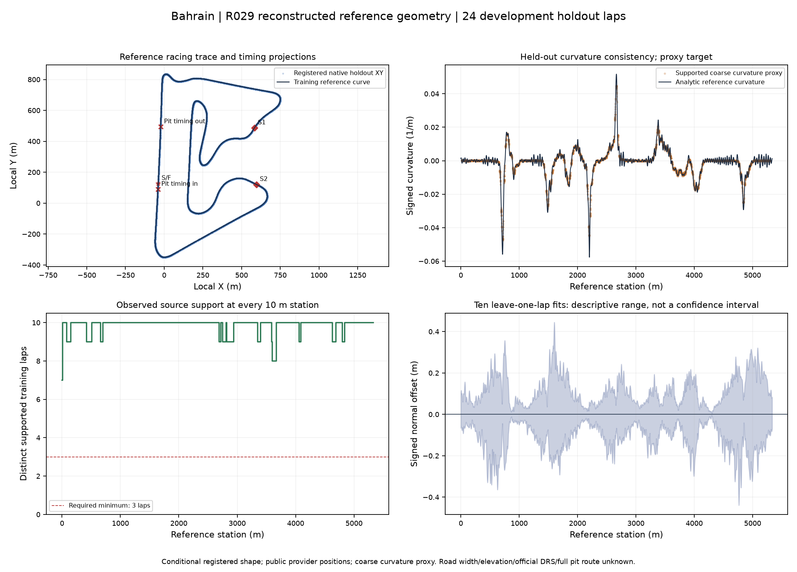
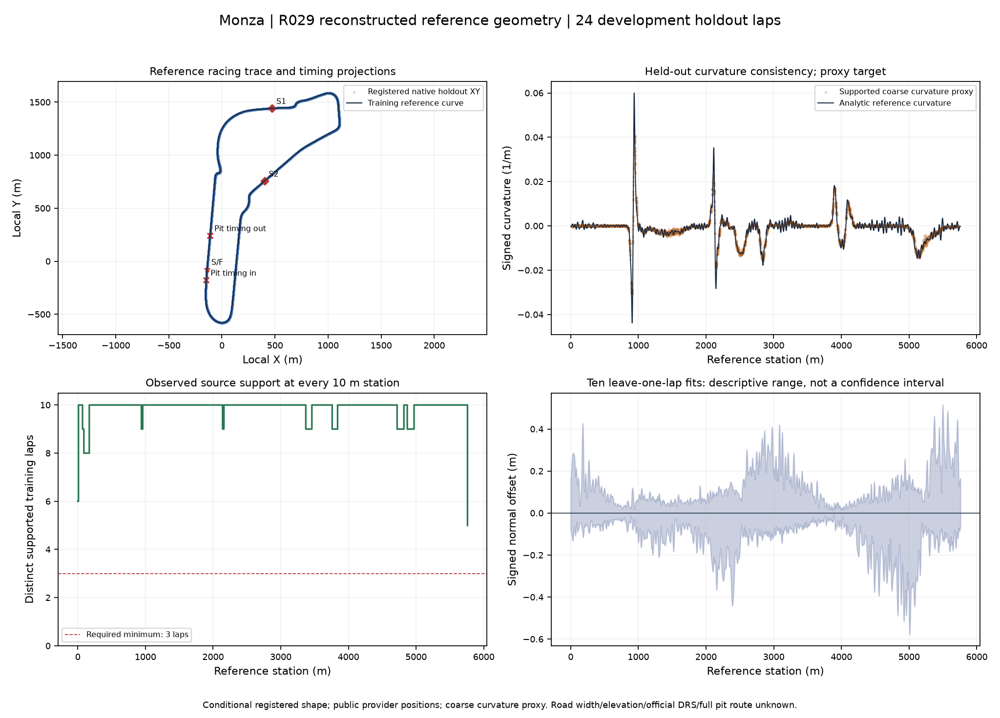

# R029 completed: source-supported reference geometry

## A. Outcome and baseline

**R029 DONE, 2026-10-20.** Bahrain and Monza pass the frozen v3 reference-geometry
gates on **all 48 test laps**, including 24 additional confirmation laps. Full
scientific replay and an independent native-table/NumPy audit pass. **544 tests
pass** and implementation CI passes Python3.11/3.12. Research inventory is now
**27/73 DONE**, build inventory **13/66 DONE**. Scoped research maturity remains
R1 and the production kernel remains R0; this is not an R2/R3 promotion.

Baseline df51bf4: fresh 523 tests pass in 246.19 s, with two existing dependency
warnings. The v1 source-audit reference command reproduces its rejected result.
The [v1 report](track-reconstruction-report.md), strict-v2 source failure and
v2.1 rejected study remain preserved. Pre-existing user artifacts/,output/,tmp/
were not staged or modified. The final accepted artifact is a new immutable run.

## B. Scope, provenance and scientific sequence

This ADAPTATION reconstructs a two-dimensional reference **RACING TRACE** from
native public positions. It is not a surveyed centerline, physical road boundary
or a minimum-lap-time paper reproduction. Four original FastF1 race archives
(Bahrain2024R01/2023R01,Monza2024R16/2023R14) and original R021/R026 eligibility
masks verify unchanged, including full archive verification before and after
fitting. Their previous 46-table offline-replay evidence remains prior evidence;
this pass does not claim new offline worker rebuilds or acquire new telemetry.
All nine permanent whole-event benchmarks remain excluded before native reads.

The [frozen v2 protocol](../../research/protocols/TRACK_RECONSTRUCTION_V2.md)
was pushed as 9b275dd before public fitting. It retains missing native interiors
as unsupported and combines observed training portions. Metadata-only source
preflight found ten eligible training and ten validation laps per circuit without
replacement. V2 development-selected coefficients/configurations were sealed
and pushed as b9a187e before holdout geometry outcomes were inspected.

Strict v2 subsequently found two unsupported test timing anchors. Its
[failure record](track-reconstruction-v2-source-failure.json) stands. The
[v2.1 extension](../../research/protocols/TRACK_RECONSTRUCTION_V2_1.md), 4133551,
was frozen before inspecting holdout geometry metrics. It omits unsupported
test anchors as UNKNOWN, requires>=98% retained time coverage and keeps complete
training/validation closure mandatory. Eight proper rigid closest-curve pose
steps compare complete/partial test observations against fixed shape coefficients.

V2.1 passed 23/24 test laps. Bahrain driver44 lap9 failed coarse proxy MAE:
0.003052064/m versus 0.003/m. Native positions reverse about 19.2m then move forward
again, creating nearly180-degree turns and two chronological proxy spikes near
0.166–0.168/m. Their cause is UNKNOWN; those derivatives do not represent a
regular forward reference trace. The complete
[rejected v2.1 evidence](track-reconstruction-v2-1-rejected-evidence.json) remains
unchanged, including that failed gate.

The [v3 protocol](../../research/protocols/TRACK_RECONSTRUCTION_V3.md), fe96688,
declares source-only forward-derivative support and adds 24 confirmation laps
before their geometry metrics are inspected. It retains all 24 earlier test laps,
the same training/validation, fitted coefficients, six candidates and every numeric
error/coverage/sensitivity threshold. It does not replace failed laps or increase
the 0.75 s source-gap limit. A metadata-only table correction maps the frozen mask
index rule to Bahrain lap29 rather than the handwritten27; the index rule is unchanged.

## C. Implementation and input accounting

Per circuit: ten 2024 driver4 training laps, ten 2024 driver44 validation laps,
twelve 2023 retrospective test laps and twelve additional2023 confirmation laps.
There are **88 laps**, **31,101 native interior positions** and **173 supported
reconstructed timing anchors**. Every retained position is scored; no positions
are removed for high model error. All 161 interior interval instances above 0.75 s
remain explicitly unsupported. Three test anchors remain UNKNOWN and omitted;
their retained observation spans are 99.38–99.87% of lap duration.

Both circuits select **K160, alpha 0.5** using validation only. Shape coefficients
are training-only Fourier ridge fits; analytic derivatives give heading and
signed curvature, with a monotone integrated arc coordinate. Source XY uses
decimetres converted to metres in a declared local mathematical plane.
The [equations](../../research/equations/SOURCE_COHERENT_CURVATURE_V3.md),
[support equations](../../research/equations/OBSERVED_TRACK_SUPPORT_V2.md) and
[pose/boundary equations](../../research/equations/OBSERVED_TRACK_BOUNDARIES_V2_1.md)
map symbols, units, masks, numerical methods and independent fixtures to code.

Source-only adjacent direction cosines<=0 make their two incident intervals
unsuitable for curvature stencils. Time support and derivative support combine
before scoring the 25 m coarse turning proxy. Fourteen reversal vertices occur in
seven test laps. Their original XY scores remain, and all unfiltered chronological
proxy values are saved as diagnostics. Unsupported target/model matches are NaN
UNKNOWN, with explicit masks. No predicted residual selects its own target mask.

All native inputs, row parents, source/unknown labels, candidates, pose transforms,
eight-step RMS histories, predictions, raw control distances, source masks,
coefficients, arc tables, donor matrices, sensitivity and annotations are sealed.
The [model/data card](../models/reference-geometry-v3.md) supplies exact commands.

## D. Quantitative acceptance

All values below concern **conditional registered shape** after rigid pose
optimization against the fixed curve. They are consistency with archived provider
positions, not measured accuracy against the physical circuit.

| Circuit | Length (m) | Lowest donor count at 10 m stations | Training raw closure maximum (m) | LOO p95/max normal offset (m) | Max absolute model curvature (1/m) |
| --- | --- | --- | --- | --- | --- |
| Bahrain | 5336.928 | 7 | 8.506 | 0.185 /0.445 | 0.05765 |
| Monza | 5760.703 | 5 | 5.806 | 0.182 /0.577 | 0.06007 |

Every sampled station passes the >=3-donor gate. Leave-one-lap offsets are
descriptive sensitivity, NOT calibrated confidence intervals. Model lengths
differ from median training chord length by 0.0017%/0.0255%; numerical length
refinement differences are below 6e-11 m. Analytic position/tangent seams pass 1e-8,
and positive derivative norms pass the 5%-of-median guard. Structural periodic
closure is reported separately from the observed raw training closure above.

Each row below reports the WORST individual lap in that stratum, not a pooled
score that could conceal a failed lap:

| Circuit / test stratum | Laps | Max lap XY RMSE (m) | Max lap XY p95 (m) | Max supported curvature-proxy MAE (1/m) | Lowest accepted target fraction |
| --- | --- | --- | --- | --- | --- |
| Bahrain retrospective | 12 | 0.1272 | 0.2724 | 0.001388 | 85.98% |
| Bahrain additional confirmation | 12 | 0.1324 | 0.2652 | 0.001345 | 92.45% |
| Monza retrospective | 12 | 0.5316 | 1.0774 | 0.001113 | 92.11% |
| Monza additional confirmation | 12 | 0.1917 | 0.3706 | 0.001136 | 89.52% |

All 48 individually pass RMSE<=6m,p95<=12m,maximum distance<=30m and backward
projection<=2%. Actual worst maximum distances are0.5672m/1.2667m and backward
fractions0.266%/0.302%. Coarse proxy p95 absolute differences stay below
0.003949/m/0.003100/m versus0.015/m allowed. At least 184/205 accepted curvature
targets remain per lap, above the 100 minimum and 75% fraction requirement.

The supported first-training-lap polyline/vertices are the positional control;
no gap or closing segment is invented. Worst p95-minus-control differences are
-0.8008m/-1.5899m, passing<=2m. This control uses less training evidence than the
ten-lap estimator; these values do not establish matched-data algorithm superiority.

The previously failed lap retains the exact unfiltered diagnostic and positional
predictions. Under the new source-only target rule, 184/214 stencils remain valid
and MAE is 0.001282367/m. The old 188/214-target comparison and 0.003052064/m failure
are still preserved. Additional confirmation and retrospective scores are separate.

Start/finish, both sector boundaries and pit-in/out timing projections are stored
with native lineage and support/spread. Each sector has ten training observations;
pit entries/exits each have two supported observations per circuit. Bahrain's
pit-entry station spread is 26.68 m at p95, a visible limit on that annotation.
These are timing projections, not surveyed pit geometry or official zones.

## E. Verification and reproducibility

- **544 full tests pass in 511.11 s**, with two existing dependency deprecation
  warnings. The 36 R029-specific checks cover analytic circle/ellipse controls,
  native lineage, partial observations, invalid inputs, complementary/common
  holes, derivative-source reversals, test isolation, unknowns, protected cohorts,
  portable replay, immutability, tamper and false promotion refusal.
- The newest combined v3 CLI smoke passes in 132.92 s. It includes missing interiors,
  a missing anchor and a reversal, while remaining explicitly SIMULATED.
- **Full public scientific replay passes**: stored training inputs refit identical
  selection/configuration, all arrays/poses/gates/support/sensitivity and final
  acceptance, without original caches. Annotation projections also replay.
- The [independent audit](track-reconstruction-v3-independent-audit.json) imports
  no geometry implementation. It checks all 88 laps against original native
  tables, timestamp/coordinate parents and source hashes, recomputes all 48 test
  scores and masks, and reproduces donor counts and sensitivity summaries.
  Coefficients and arc tables are byte-for-value equal to development. Earlier
  positional predictions and unfiltered proxy diagnostics reproduce v2.1.
- [Implementation CI](https://github.com/aayups31/APEX/actions/runs/39371854814)
  passes Python3.11/3.12, including the combined source-coherent artifact step.
  Lint and diff checks pass; final figures were rendered and visually inspected.

The [sealed study JSON](track-reconstruction-v3-study.json),
[verification evidence](track-reconstruction-v3-evidence.json), native audit,
equation/model cards, figure sources and reports are committed. Bulk native
arrays remain ignored in `.cache/r029-v3-research-20261020`.

Study summary seal:
`e22c1c6e0bf35a195120e47e6198c02d38549af4d51d38ef9f400c125d4ba684`.
Artifact manifest seal:
`0caa4285294656c9d223ae4c79348c7f0990ff117c04e6f026947e4d0b7d0162`.
Independent audit seal:
`87dc54394ea76a4162ce70e0f762bf0b08cfb185a77ee99d44b8fe73039e1ffe`.

An interrupted attempt produced no completed v3 artifact. All accepted evidence
comes from the fresh 2026-10-20 run. Reverting the research implementation commits
returns to the verified df51bf4 baseline; production race sampling is unchanged.

## F. Limits

Public provider positions can contain upstream reconstruction and coherent map
structure. Very small registered residuals do NOT establish sub-metre physical
survey accuracy. Whole-lap rigid pose optimization is not online localization.
Coarse curvature remains a source-conditioned proxy. Only two same-circuit,
cross-season development cases are studied; added laps are not independent new
events, unseen circuits or the untouched benchmark. Sensitivity is conditional,
not calibrated population uncertainty. Support is checked on a 10 m station grid.

Physical width, surveyed centerline, validated elevation, official DRS zones and
full pit route remain UNKNOWN and unsupported use raises errors. This completes
R029's reconstructed-reference geometry acceptance; full Master Guide 9.2 production
track promotion, vehicle dynamics, closed-loop replay and world-model validation
remain separate. No team interest, private-data equivalence or production/R3
maturity is inferred from this result.

## G. Next

R030 longitudinal calibration is now dependency-ready. R027 explanation faithfulness
and R028 feasible counterfactuals remain unblocked TODO P1 studies and can be
handled in a dedicated next pass. None of those tasks is silently marked complete
or started here. This run stops after R029 closure and frequent main checkpoints.
