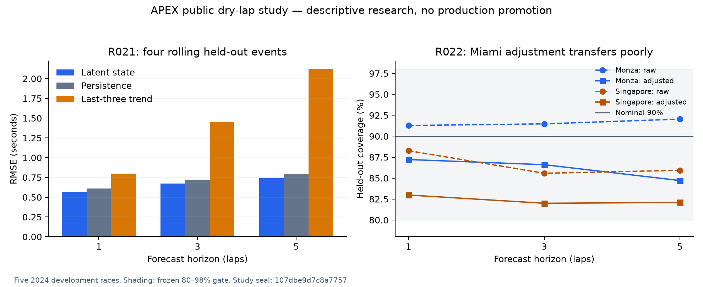

# R021/R022 public-data tyre-pace study

## A. Current state and baseline

**R021 DONE; R022 DONE**, 2026-10-11. Research inventory **22/73 DONE**;
build inventory remains 13/66. Scoped research foundation R1, production kernel
R0; no automatic R2 review or production promotion follows this study.

Baseline `1f77156`: 450 passed, two existing dependency warnings, 127.44 s at
`.cache/r021-r022-baseline-20261011`. The earlier qualifying-only development
corpus could not establish race-stint pace. The legacy Kalman starter's
whole-sequence percentile baseline remains educational and was not reused for
causal public-data evaluation. Pre-existing user artifacts were preserved.

## B. Completed scope

R021 adds fuel-corrected latent pace fitting, causal 1/3/5-lap predictions, pit/gap
resets and whole-event rolling evaluation against matched persistence/trend
baselines. R022 adds conditional Bayesian compound/track/driver inference,
unseen-group uncertainty, two-chain diagnostics and separate validation-only
predictive interval adjustment. Both have immutable CLI artifacts, all-chain
posterior arrays, source/model cards and independent numerical/causality tests.

This is an **ADAPTATION**, motivated by the reviewed
[Cappello/Hoegh abstract](https://arxiv.org/abs/2512.00640), not verified paper
equation reproduction or the Austrian/Hamilton/skewed-t result. APEX's Gaussian
equations and deviations are in the [unit/equation map](../../research/equations/TYRE_PACE_V1.md).

## C. Data, lineage and frozen protocol

The [protocol](../../research/protocols/TYRE_DEGRADATION.md) was frozen before
inspection of these newly acquired race archives. It defines all masks, priors,
fits, splits, sampler budgets and acceptance thresholds. Only source-review
wording was clarified afterward; numerical gates and selection stayed fixed.

| 2024 development race | Native laps | Retained segments | Eligible laps |
| --- | ---: | ---: | ---: |
| Bahrain, round 1 | 1,129 | 67 | 935 |
| Australia, round 3 | 998 | 57 | 815 |
| Miami, round 6 | 1,111 | 49 | 817 |
| Monza, round 16 | 1,008 | 49 | 886 |
| Singapore, round 18 | 1,177 | 45 | 1,085 |
| Total | 5,423 | 267 | 4,538 |

All five complete FastF1 archives pass exact offline replay, zero network
attempts and zero table mismatches. A fresh archive verification after evaluation
confirms unchanged source seals. Every one of 885 excluded native rows has
reasons in the evidence; overlapping reason totals are not distinct row counts.
No numerical pace outliers were removed. These archives form a dedicated slim
race dataset, separate from R019's two-provider qualifying corpus.

The [data card](../data/tyre-pace.md) distinguishes FastF1 parsed source values
from fixed fuel PRIORs (105 kg, 1.4 kg/lap, .030 s/kg), corrected pace PROXYs
and latent MODEL_ESTIMATEs. Fuel sensitivity uses .020/.040 without selecting a
new primary. The nine whole-event permanent benchmarks remain untouched;
policy seal `7d690115b7bcd0a52f20acdbf44e628e82efe556b48caf5ebe49b15e29b4ea7d`.

## D. Implementation and measured results

R021 trains on Bahrain then rolls accumulated whole-event training forward to
Australia, Miami, Monza and Singapore. Every fit uses training observations only;
held-out prefixes update state after arrival. All three methods share the same
3,403 / 3,003 / 2,603 origins at horizons 1 / 3 / 5 respectively.

| Horizon (laps) | State MAE (s) | State RMSE (s) | Persistence RMSE (s) | Trend RMSE (s) |
| --- | ---: | ---: | ---: | ---: |
| 1 | .3752 | .5663 | .6114 | .7971 |
| 3 | .4793 | .6731 | .7214 | 1.4479 |
| 5 | .5490 | .7424 | .7895 | 2.1193 |

State RMSE improves on both baselines at all horizons. One-lap MAE is slightly
worse than persistence (.3743 s), so this is not universal metric superiority.
Baseline intervals/NLL borrow state-model variance and are an approximation;
the point-error comparison is primary. Full event/compound metrics, fit attempts,
training likelihoods and all frozen fuel sensitivities are retained.

R022 trains on Bahrain+Australia only (124 segments); Miami alone calibrates;
Monza+Singapore are test events. Two chains use seeds 11/23, 1,500 warmup and
1,500 retained draws each. Maximum population/supported-drift split R-hat is
**1.00196**; group-variance R-hats are 1.00055/.99936/.99989. The sealed posterior
has shape **2 × 1,500 × 26**, plus three positive sampled group variances per draw.
Q/R are training plug-in estimates (.039798/.152364 s²).

| Horizon | Test targets | RMSE (s) | Raw 90% coverage | Adjusted coverage | Adjusted mean width (s) | Coverage bootstrap 95% |
| --- | ---: | ---: | ---: | ---: | ---: | --- |
| 1 | 1,877 | .6044 | 89.61% | 84.87% | 1.4212 | 82.49–87.35% |
| 3 | 1,689 | .7055 | 88.16% | 84.01% | 1.8102 | 81.41–86.74% |
| 5 | 1,501 | .7730 | 88.54% | 83.21% | 2.0033 | 80.34–85.94% |

The Miami scales (1.36571/1.46892/1.40857) narrow intervals and **worsen held-out
coverage relative to nominal 90%**. Per-event adjusted coverage is Monza
87.22/86.60/84.71%, Singapore 82.98/82.00/82.09%. This is a measured calibration
transfer limitation, not successful nominal 90% calibration. PIT means
.438/.428/.425 and full ten-bin histograms reveal additional predictive bias.
Mixture NLL, raw interval widths and per-compound results remain in evidence.
Bootstrap resamples 94 segment clusters 500 times; it does not establish
multi-season generalization. Parameter intervals were never adjusted.

## E. Acceptance and verification

Both original frozen task gates pass. R021 has finite successful training-only
fits, independent hand/GLS fixtures and matched real-data rolling metrics. R022
has finite positive posterior variances, supported split R-hat ≤1.10, ≥100 test
targets per horizon, adjusted aggregate coverage within the preregistered
**80–98% tolerance** and positive mean widths ≤20 s. That tolerance is a
descriptive completion gate, not an exact nominal-coverage guarantee. No test
retuning, threshold relaxation or synthetic replacement of public evidence occurred.

- Full regression: **469 passed**, two pre-existing FastAPI/Starlette warnings,
  193.50 s; single-thread limits, cwd `apex_engine`, fresh
  `.cache/r021-r022-full-regression-20261011`.
- New numerical/data/artifact tests: **19 passed**, 26.95 s. Mutating held-out
  targets leaves training hierarchy, posterior arrays and Miami calibration
  unchanged; future observations cannot change earlier forecast means.
- Ruff and Airflow compile pass. The registry metadata update separately passes
  its two existing research interface tests.
- [Implementation CI 38198207965](https://github.com/aayups31/APEX/actions/runs/38198207965):
  Python 3.11/3.12 pass all tests and all artifact smoke steps.
- CLI reload verifies all eight artifact file hashes, completion seal, input/
  summary binding and posterior arrays without refitting. Synthetic smoke has
  `task_closure_eligible=false` and cannot close these tasks.
- Independent final rerun reproduces all four forecast/fit JSON artifacts and
  both posterior arrays exactly, with scientific settings unchanged.

Bulk artifacts: `.cache/tyre-study-final-20261011`. Input dataset seal
`d79966d3b13c06cb8a0bd6f6bcff1690a10965d6414e0e71840ecf6d7811d6a2`.
Final study seal
`107dbe9d7c8a7757d99f0a5a24e4ee9bef8880dc111e2c61b0b831644bf9de95`.
The [machine evidence](tyre-degradation-evidence.json) includes full aggregate
results, source/rejection inventories, replay reports, fit configs and artifact
hashes. Evidence seal
`7de203f86ae4e6398db9234f3b3a875fa8ace231f5dcd00561aa2424028867f8`.

## F. Limits and promotion boundary

Unmeasured fuel, driver/car/traffic/weather confounding, upstream reconstructed
fields, retrospective masks, two training tracks, correlated origins, weak group
identification and Gaussian tails remain limitations. Global hierarchical draws
are fixed while per-draw state filters process prefixes: a modular approximation,
not full parameter updating on test data. R-hat alone does not prove identification.
No live racing controller, physical-wear truth, current-F1 simulator accuracy,
full-paper replication, world-model validation or production promotion is claimed.
See the [model card](../models/tyre-pace-v1.md).

## G. Version control and next work

Implementation checkpoint **648ff20** was pushed directly to `main` before
closure. This report, machine evidence, diagnostics, updated research catalog,
maturity inventory and DONE rows form the closure checkpoint. Bulk archives,
predictions and weights stay ignored; user artifacts remain unstaged.

Next dependency-priority P0 work is **R024**: a tyre-energy proxy dataset with
complete measured/proxy provenance, followed by R025's matched forecast baselines.
**R023** remains a separate robust skewed-t study with frozen CRPS/RMSPE
accept/reject comparison; it must not be assumed to repair this calibration issue.
A separate R2 maturity review is still required before changing maturity claims.
