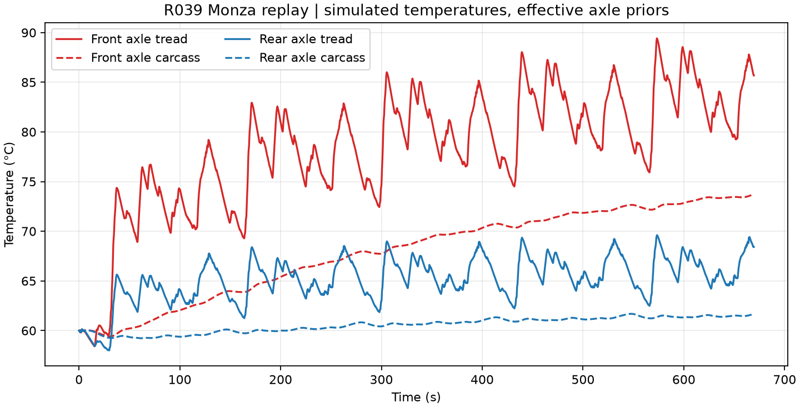

# R039 two-node tyre thermal verification

The two thermal nodes represent effective axle tread and carcass temperatures.
The tread responds to simulated lateral slip and exchanges heat with the road.
The carcass stores heat, receives a declared share of rolling loss, and exchanges
heat with air. The model carries both temperatures through each continuous lap.
Its heat capacities, conductances, bath temperatures, and heat partition are
declared priors. [Protocol and primary source](../../research/protocols/TYRE_THERMAL.md)

For tread temperature `Tt`, carcass temperature `Tc`, capacities `Ct`, `Cc`,
conductances `k`, `kr`, `ka`, and imposed inputs `Pt`, `Pc`, the equations are

```text
Ct dTt/dt = Pt + kr (Troad - Tt) - k (Tt - Tc)
Cc dTc/dt = Pc + ka (Tair - Tc) + k (Tt - Tc)
delta stored energy = integral(Pt + Pc + road exchange + air exchange) dt
```

The implementation integrates held inputs with a matrix exponential. Independent
DOP853 integration solves the two temperature equations from the same replay
forcing. The closed-form adiabatic exchange test separately checks the sign and
rate of internal conduction.

All four verified five-lap R037 learned trajectories passed across 26,780 held
command intervals. The largest per-interval energy residual was 7.96e-11 J.
The largest temperature difference from independent integration was 2.85e-12 K.
Both complete thermal run inventories and saved temperature arrays reproduced
byte for byte. [Summary](thermal-summary.json) · [Case results](thermal-results.json) · [Replay receipt](thermal-replay.json)



The two-axle bicycle replay cannot resolve temperatures by wheel. Real tyre
temperature validation requires measured temperatures and heat-partition evidence.
The accepted scope is the numerical heat balance and conditional temperature
response. Wear coupling belongs to R040.

```powershell
apexsim run-tyre-thermal-study --recovery .cache/r037-public-20261101 --verification docs/verification/recovery-public-replay.json --output .cache/thermal-fresh
```

R039 is complete for this research scope. Both Python 3.11 and 3.12 implementation
CI jobs passed 758 tests. [Implementation CI](https://github.com/aayups31/APEX/actions/runs/41701813990)
